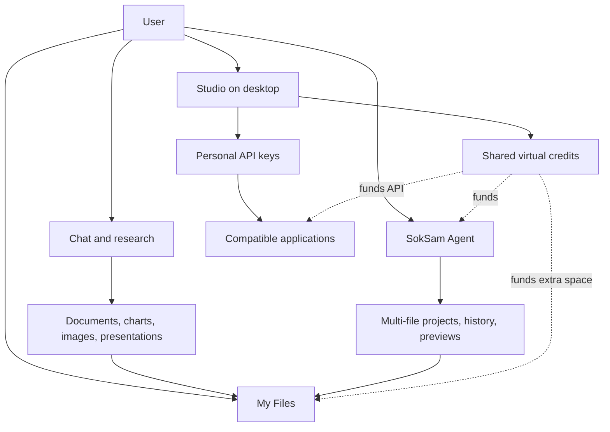

# SokSam AI — Public workflow map

This is a **conceptual product map**, not an infrastructure, network or database diagram.

## Model selection

Chat offers **SuperFlash, Standard, Nova and Max**. An adaptive backend pool of **around 50 eligible models** serves the public tiers, with selection varying according to availability and workload. The specific private provider, routing weights and fallbacks are not public. Studio offers a separate **eight-variant** catalog for API use.

## Workspaces

- **Chat:** questions, source-based research, document and data creation, images, voice, and conversation organization.
- **Agent:** projects spanning multiple files, executed in a server-side isolated environment; progress, checks, revisions and supported previews.
- **My Files:** personal folders, source and output files, versions, viewers and editing.
- **Studio:** desktop API-key management, compatible connection information, usage and virtual credit history.

The shared virtual balance funds Agent, API requests and extra My Files storage. Ordinary Chat does not debit Studio credits, though it has its own usage limits.

## Boundary of this document

Not published: credentials, private provider identities, model routing internals, deployment topology, server paths, security-sensitive administrative capabilities, user records or private databases.

[Agent](AGENT.md) · [Credits](CREDITS.md) · [Files](MY-FILES.md) · [Product overview](PRODUCT-OVERVIEW.md)
